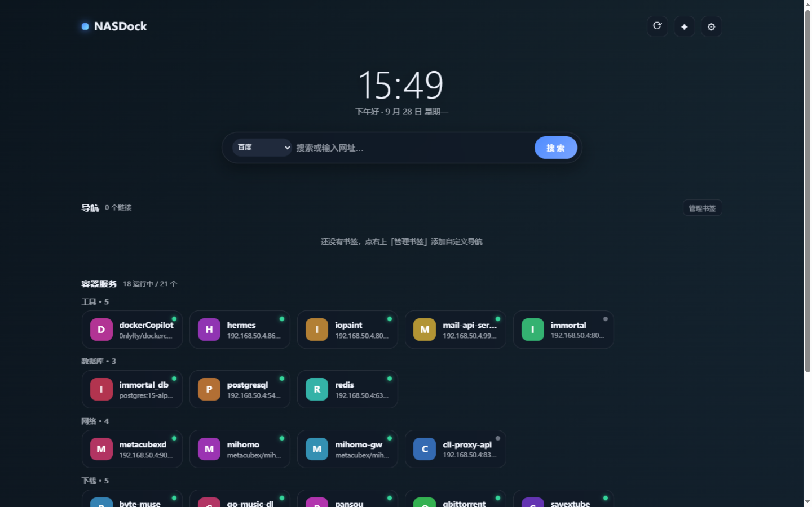

# NASDock · 容器自动发现主页

为 Homelab / NAS 打造的**自托管浏览器主页**：自动扫描 Docker 容器生成服务卡片，支持收藏夹 HTML 导入、壁纸（必应每日 / 随机美图 / Wallhaven 关键词图库）、自定义书签导航、深浅色主题。单容器部署，无数据库。



## ✨ 功能

- **容器自动发现**：只读挂载 `docker.sock`，自动扫描容器名称 / 端口 / 运行状态，支持 host 网络模式，按 影音 / 下载 / 网络 / 数据库 / 工具 自动分类
- **图标全自动**：内置图标库（[walkxcode/dashboard-icons](https://github.com/walkxcode/dashboard-icons)）→ 站点 favicon → 彩色字母头像，三级回退；也可在编辑弹窗里**自动抓取**站点 Logo 或**上传**自定义图标
- **凭据管理**：自动从容器环境变量提取账号 / 密码 / Token（默认隐藏，卡片锁图标按需查看 / 复制），支持手动补充
- **收藏夹导入**：浏览器导出书签 HTML → 选择文件夹一键导入；自动清洗网页标题（去 `Powered by` / `首页` 等噪音）、URL 去重
- **壁纸**：内置渐变 / 必应每日一图 / 随机美图（Picsum）/ Wallhaven 关键词图库 / 自定义上传
- **搜索**：百度 / Google / 必应 / DuckDuckGo 可切换，输入网址直达
- **分组折叠**（状态记忆）、**深浅色主题**、**隐藏不需要的容器**（可恢复）

## 🚀 快速开始

```bash
mkdir -p nasdock/config && cd nasdock

# 把下面的 docker-compose.yml 保存到当前目录
nano docker-compose.yml

docker compose up -d
```

浏览器访问 `http://NAS_IP:7788/?token=你的令牌`（首次带 token 自动记住），然后把该地址设为浏览器主页即可。

> 默认端口 `7788`，可在 compose 里修改。

## 📦 docker-compose.yml

```yaml
services:
  nasdock:
    build: .
    image: nasdock:latest
    container_name: nasdock
    restart: unless-stopped
    ports:
      - "7788:8000"
    environment:
      TZ: Asia/Shanghai
      WEB_TOKEN: "change-me-to-a-random-secret"   # 访问令牌，务必修改
    volumes:
      - ./config:/config
      - /var/run/docker.sock:/var/run/docker.sock:ro   # 只读！
```

生成随机令牌：`python3 -c "import secrets; print(secrets.token_urlsafe(18))"`

## 🧩 新标签页扩展（可选）

浏览器"新标签页"无法通过设置修改网址，需要一个极简扩展（仓库 `extension/` 目录）：

1. 修改 `extension/redirect.js` 里的地址为你的 NASDock 地址（建议带上 `?token=`）
2. Edge / Chrome 打开扩展管理页（`edge://extensions` / `chrome://extensions`）
3. 开启开发者模式 → 「加载解压缩的扩展」→ 选择 `extension` 目录
4. 之后每开一个新标签页就是 NASDock

## 🔒 安全说明

- **docker.sock 建议始终只读挂载**（`:ro`），NASDock 只读取容器列表
- 所有管理接口需要 `WEB_TOKEN` 鉴权；凭据加密文存储在服务端配置中，默认不在卡片上显示
- 请仅在**局域网 / 可信网络**中使用；如需公网访问请自行加反向代理 + HTTPS

## 🛠 技术栈

Python Flask + Docker SDK + 原生 JS（无构建步骤），图标来自 [walkxcode/dashboard-icons](https://github.com/walkxcode/dashboard-icons)，壁纸源：[Bing](https://cn.bing.com)、[Picsum](https://picsum.photos)、[Wallhaven](https://wallhaven.cc)。

## License

[MIT](LICENSE)
